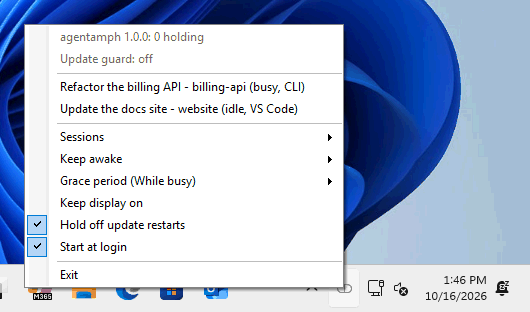

# agentamph

agentamph keeps Windows awake for the Claude Code sessions you choose. It sits in the notification area and lists every Claude Code session running on your machine, from the CLI or the VS Code extension. Mark the ones that matter as critical, and Windows won't sleep while they run. It also holds off Windows Update restarts while they run, so a long task isn't cut short.

It runs without administrator rights, keeps everything on your machine, and you can read every line of it: it is a few PowerShell scripts.



agentamph is an independent project. It is not made or endorsed by Anthropic. Its nickname is Agent Amphetamine, after the Mac app that keeps Macs awake; the product is agentamph.

## Requirements

- Windows 11. It is the only version tested.
- Claude Code, as the CLI or the VS Code extension.
- No administrator rights. agentamph installs for the current user, and uses Windows PowerShell 5.1, which comes with Windows.

## Install

In PowerShell, run:

```powershell
irm https://raw.githubusercontent.com/jackmossman/agentamph/main/install.ps1 | iex
```

This downloads the latest release from GitHub, installs it under `%LOCALAPPDATA%\Programs\agentamph`, and starts it. agentamph then appears in the notification area, in the Start Menu, and in **Settings > Apps > Installed apps**. It starts at login from then on.

Windows 11 puts a new tray icon in the overflow menu (the **^** next to the clock). To keep agentamph's icon on the taskbar, drag it there, or turn it on under **Settings > Personalization > Taskbar > Other system tray icons**.

### From the release zip

If you'd rather not pipe a script from the internet into PowerShell:

1. Download `agentamph-<version>.zip` from the [latest release](https://github.com/jackmossman/agentamph/releases/latest). Each release lists the zip's SHA-256, which you can compare with `Get-FileHash .\agentamph-<version>.zip`.
2. Extract it, and open PowerShell in the extracted folder (the one holding `install.ps1`).
3. Windows marks downloaded files as unsafe. Unblock them:

   ```powershell
   Get-ChildItem -Recurse | Unblock-File
   ```

4. Run the installer:

   ```powershell
   powershell -ExecutionPolicy Bypass -File .\install.ps1
   ```

You can delete the extracted folder afterwards. The zip also contains these steps as `INSTALL.txt`.

To update, install again either way. Your settings and critical marks are kept.

### Uninstall

Open **Settings > Apps > Installed apps**, find agentamph, and choose **Uninstall**. Or run:

```powershell
powershell -ExecutionPolicy Bypass -File "$env:LOCALAPPDATA\Programs\agentamph\uninstall.ps1"
```

Either way removes everything listed under [What it touches](#what-it-touches) and puts back your Active Hours. If you installed the plugin, remove it in Claude Code with `/plugin uninstall agentamph@agentamph`.

## The Claude Code plugin (optional)

The plugin lets you mark a session critical from inside it: start a prompt with **this session is critical**. agentamph picks up the mark within a second, and Claude tells you in one line that the session is now marked.

Install it in Claude Code:

```text
/plugin install agentamph --marketplace jackmossman/agentamph
```

That works in one step on Claude Code 2.1.275 or later. On older versions, add the marketplace first:

```text
/plugin marketplace add jackmossman/agentamph
/plugin install agentamph@agentamph
```

The phrase counts when it appears anywhere on a prompt's first line, in any case. To use a different phrase, set the plugin's `trigger_phrase` option: open `/plugin`, choose agentamph and **Configure**, or set it when installing from a terminal:

```powershell
claude plugin install agentamph --marketplace jackmossman/agentamph --config trigger_phrase="keep me awake"
```

The plugin only writes the mark. The tray app does the keeping awake, so install it too. A session marked while the tray app isn't running is kept awake once it starts, and Claude tells you the app isn't running yet.

## Using it

Right-click the tray icon to open the menu. The icon is a grey capsule while nothing holds the machine awake. It turns amber with a count while sessions hold it. Hover over it to see what it's doing.

- **The session list** shows each running session by name, with its folder, whether it is busy or idle, and where it runs (CLI or VS Code). Click a session to mark it critical, and click again to unmark it. A session that is keeping the machine awake shows **[holding]**. A mark follows a session through `/clear` and compaction. Once a session is gone, its mark is removed when it is 30 days old.
- **Sessions** chooses which sessions can hold the machine awake: **Critical** (the default) for the sessions you marked, or **All** for every session.
- **Keep awake** chooses for how long:
  - **Until closed** (the default) holds for as long as a session is open, even while it waits for your reply. A session waiting for input stays reachable, for example over Claude Code's Remote Control from your phone.
  - **While busy** holds only while Claude is working, plus a grace period afterwards.
- **Grace period (While busy)** is how long a session keeps holding after it finishes: none, 2 (the default), 5 or 10 minutes.
- **Keep display on** keeps the screen on too, not just the system. It is off by default: the screen can turn off and lock while the work carries on.
- **Hold off update restarts** turns on the update guard (on by default, below).
- **Start at login** starts agentamph when you sign in. The installer turns it on.

### The update guard

Windows restarts for updates outside your Active Hours. While a session holds the machine awake, the update guard keeps the current time inside Active Hours. It sets them to start an hour before now and run for 18 hours, Windows' maximum, and moves them along as time passes. Your own Active Hours are saved first. They are put back as soon as nothing holds, when agentamph exits, or when it is uninstalled.

The menu shows whether the guard is holding. If an update is waiting for a restart while sessions hold, agentamph tells you once, so you can restart at a good moment.

The guard can't stop everything:

- A restart forced by an update deadline, which an organization can set, still happens.
- When Group Policy sets Active Hours, the guard can't change them. The menu shows it as unavailable, and agentamph changes nothing.

## What it touches

Everything agentamph reads or writes:

| | Where | What |
|---|---|---|
| Reads | `%USERPROFILE%\.claude\sessions\*.json` (or under `CLAUDE_CONFIG_DIR`) | Claude Code's small per-session status files: process id, session id, folder, name, busy or idle. Nothing else in `.claude`. |
| Reads | The process list | Whether each session's process is still running, and `claude.exe` processes if the session files can't be read. |
| Writes | `%LOCALAPPDATA%\Programs\agentamph\` | The program. |
| Writes | `%LOCALAPPDATA%\agentamph\` | `settings.json`, the critical marks under `critical\`, `state.json` (which process had which session), and `tray.log` (what the app did, started afresh at 1 MB). |
| Writes | `%APPDATA%\Microsoft\Windows\Start Menu\Programs\agentamph.lnk` | The Start Menu shortcut. |
| Writes | `HKCU\Software\Microsoft\Windows\CurrentVersion\Run`, value `agentamph` | Start at login. |
| Writes | `HKCU\Software\Microsoft\Windows\CurrentVersion\Uninstall\agentamph` | The entry in Installed apps. |
| Writes | `HKCU\Software\agentamph\UpdateGuard` | A copy of your Active Hours while the update guard holds. Removed when they are put back. |
| Writes | `HKLM\SOFTWARE\Microsoft\WindowsUpdate\UX\Settings`, values `ActiveHoursStart`, `ActiveHoursEnd` and `SmartActiveHoursState` | Active Hours, while the update guard holds. Windows lets a standard user change these, as Settings does. Put back afterwards. |
| Reads | `HKLM\SOFTWARE\Policies\Microsoft\Windows\WindowsUpdate`, value `SetActiveHours` | Whether Group Policy sets Active Hours. |
| Reads | `HKLM\SOFTWARE\Microsoft\Windows\CurrentVersion\WindowsUpdate\Auto Update\RebootRequired` | Whether an update is waiting for a restart. |
| Uses | The system's power requests | A request that keeps the system (and, if you choose, the display) on, through `SetThreadExecutionState`. It shows in `powercfg /requests`, and Windows drops it when agentamph exits. |
| Plugin | `%LOCALAPPDATA%\agentamph\critical\` | The plugin writes a session's critical mark here, and nothing else. To check the first line, its hook briefly copies its input to `%TEMP%\agentamph-hook-*.json` and deletes it straight away. |
| Installer | `%TEMP%\agentamph-install-*` | The one-line install downloads the release here, and deletes it once installed. |

## Privacy

- The tray app reads only Claude Code's session status files. It never reads transcripts, prompts, settings or credentials.
- The plugin's hook reads each prompt only to check its first line for the trigger phrase. It never stores or logs prompt text. Its only outputs are the mark, which holds the time it was made, and a one-line note to Claude. The hook's input passes through a temporary file for the moment of the check, as noted above.
- Nothing makes a network connection, except the one-line installer downloading agentamph from GitHub.

Tests enforce these. One feeds the hook prompts carrying a unique marker, with and without the trigger phrase, and checks the marker appears nowhere in agentamph's folders, its registry key or the temporary folder. Another checks that no script outside the installer contains a networking command.

## How it compares

Checked in October 2026. Most tools that keep a machine awake for Claude Code are for macOS, and hold the machine only while Claude is working.

- **Claude Code itself** keeps a Mac awake with `caffeinate` while a turn runs. It holds nothing while a session waits for input, and according to an open issue it does nothing on Windows ([anthropics/claude-code#96679](https://github.com/anthropics/claude-code/issues/96679), September 2026).
- **[cc-caffeine](https://github.com/samber/cc-caffeine)**, a Claude Code plugin with an Electron tray app, held per session while busy, on macOS, Linux and Windows. It was marked deprecated in September 2026 and recommends Amphetamine, a macOS app.
- **[claudfeine](https://github.com/maxgfr/claudfeine)** (July 2026) wraps the `claude` command and keeps the machine awake for as long as that process runs, on macOS, Linux and Windows. It can't tell sessions apart, or busy from idle.
- **[claude-keep-awake](https://github.com/AxGord/claude-keep-awake)** (September 2026), a plugin for macOS, Linux and Windows, holds the machine while any session is busy, and lets go when Claude waits for you.
- **macOS menu bar apps** such as [Claffeinate](https://github.com/matwu/Claffeinate) and [AwakeBar](https://github.com/jpbarbosa/awakebar) (both 2026) hold per session while busy. AwakeBar also holds idle Remote Control sessions, up to a timeout.
- **[PowerToys Awake](https://learn.microsoft.com/en-us/windows/powertoys/awake)** keeps Windows awake indefinitely, for a set time, or until a process ends. It doesn't know about Claude Code sessions.

What agentamph adds, on Windows:

- **Per-session critical marks.** You choose which sessions matter, from the tray or with a phrase in a prompt, instead of holding the machine for every session or none.
- **Until closed.** A marked session keeps the machine awake while it waits for your reply, so you can answer it over Remote Control instead of finding the machine asleep.
- **The update guard.** None of the tools above stops Windows from restarting for updates in the middle of a long task.

## Limitations

- Windows only.
- agentamph reads Claude Code's session files, which are undocumented and could change. If it can't read them, it says so in the menu and falls back to listing `claude.exe` processes. Those all count as busy, and can't be marked one by one.
- A restart forced by an update deadline still happens.
- Closing a laptop's lid still does what Windows is set to do. To keep working with the lid closed, set **When I close the lid** to **Do nothing** in the power settings.
- It sees only sessions on this machine. Sessions in the cloud or on other machines aren't listed.

## Contributing

Run the tests with `powershell -ExecutionPolicy Bypass -File scripts\test.ps1` (Pester 5, under Windows PowerShell 5.1). The VM tests in [`tests/vm`](tests/vm/README.md) install agentamph on a clean Windows 11 VM. Each release gets a [`CHANGELOG.md`](CHANGELOG.md) entry and a matching tag.

To report a security problem, see [SECURITY.md](SECURITY.md).

## License

[MIT](LICENSE)
